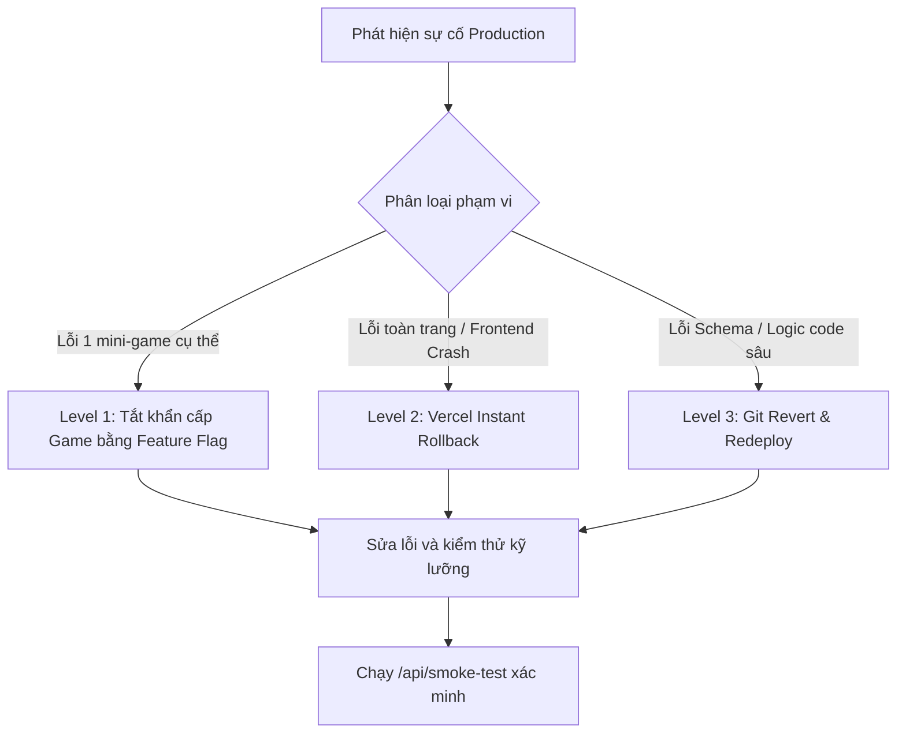

# Deployment, Monitoring & Rollback Runbook (Task T-019)

Tài liệu hướng dẫn quy trình vận hành, triển khai môi trường Production, giám sát uptime và kịch bản ứng cứu khẩn cấp / rollback dự phòng cho **English Game Hub MVP**.

---

## 1. Kiến trúc triển khai Production

- **Frontend & API Routes:** Next.js 15 App Router lưu trữ trên Vercel Edge/Serverless Network.
- **Cơ sở dữ liệu & Xác thực:** Supabase Managed Postgres (PostgreSQL v15+) & Supabase Auth.
- **Lưu trữ tài nguyên tĩnh (Static Assets):** Supabase Storage / Public CDN (`images.unsplash.com`).
- **Domain & SSL:** HTTPS tự động kích hoạt với chứng chỉ TLS 1.3 và Security Headers cấu hình trong `next.config.ts`.

---

## 2. Thiết lập biến môi trường (Environment Variables)

Cấu hình các biến sau trên Vercel Project Settings > Environment Variables:

| Tên biến | Phạm vi | Mô tả | Mẫu giá trị |
|---|---|---|---|
| `NEXT_PUBLIC_SUPABASE_URL` | Client & Server | URL endpoint dự án Supabase | `https://xyzcompany.supabase.co` |
| `NEXT_PUBLIC_SUPABASE_ANON_KEY` | Client & Server | Khóa ẩn danh an toàn cho client | `eyJhbGciOi...` |
| `SUPABASE_SERVICE_ROLE_KEY` | **Server Only** | Khóa đặc quyền dịch vụ (Tuyệt đối không để lộ) | `eyJhbGciOi...` |
| `NEXT_PUBLIC_SITE_URL` | Client & Server | URL chính thức của ứng dụng | `https://english-game-hub.vercel.app` |

---

## 3. Các bước triển khai (Deployment Workflow)

### Bước 1: Kiểm duyệt mã nguồn địa phương (Pre-flight Checks)
Trước khi push code lên nhánh `main`, bắt buộc chạy:
```bash
npm run typecheck   # Xác nhận TypeScript strict không có lỗi
npm run lint        # Xác nhận ESLint 0 warnings / 0 errors
npm run test        # Xác nhận 100% test suites pass (> 200 tests)
npm run build       # Xác nhận Next.js SSG build hoàn tất
```

### Bước 2: Đồng bộ Database Migrations & Seed
Áp dụng migration vào cơ sở dữ liệu Supabase Production:
```bash
npx supabase db push
# Nạp dữ liệu seed nếu khởi tạo mới:
# psql $DATABASE_URL -f supabase/seed.sql
```

### Bước 3: Triển khai tự động qua Vercel
- Đẩy commit lên nhánh `main`: `git push origin main`.
- Vercel tự động build và gán domain production.

---

## 4. Giám sát & Đánh giá Sức khỏe hệ thống (Monitoring)

### 4.1 Uptime & Health Check Endpoint
- **URL:** `GET /api/health`
- **Mục đích:** Kiểm tra trạng thái máy chủ, uptime, bộ nhớ heap và cấu hình Supabase.
- **Thiết lập:** Kết nối với công cụ ping định kỳ 1 phút/lần (UptimeRobot, BetterUptime, Datadog).
- **Mã phản hồi chuẩn:** `HTTP 200 OK`
```json
{
  "status": "healthy",
  "uptimeSeconds": 1420,
  "service": "english-game-hub",
  "version": "0.1.0"
}
```

### 4.2 Tự động chạy Smoke Test sau khi triển khai
- **URL:** `GET /api/smoke-test`
- **Mục đích:** Chạy tự động chuỗi kiểm thử giả lập đánh giá toàn bộ 6 mini-games ngay trên môi trường live.
- **Mã phản hồi chuẩn:** `HTTP 200 OK` (`allPassed: true`, `testsPassed: 6`).

---

## 5. Quy trình Ứng phó sự cố & Kịch bản Rollback (Incident Runbook)

Khi phát hiện lỗi nghiêm trọng trên Production (lỗi gameplay, rò rỉ bảo mật, crash ứng dụng), đội ngũ thực hiện theo 3 cấp độ sau:



### Cấp độ 1: Tắt tức thời mini-game bị lỗi (Zero-Downtime Feature Flag)
*Thời gian thực hiện: < 15 giây. Không cần redeploy.*
Nếu 1 game cụ thể (ví dụ: `listen-choose` gặp lỗi âm thanh hoặc nội dung), quản trị viên có thể tạm thời vô hiệu hóa game này trực tiếp trong cơ sở dữ liệu:
```sql
UPDATE public.games
SET is_enabled = false
WHERE slug = 'listen-choose';
```
Trang thư viện `/games` sẽ tự động ẩn game bị lỗi để người học không gặp phải trải nghiệm gián đoạn.

### Cấp độ 2: Vercel Instant Rollback (Khôi phục bản triển khai trước)
*Thời gian thực hiện: < 30 giây.*
Nếu lỗi xảy ra do mã nguồn frontend mới deploy:
1. Truy cập **Vercel Dashboard > English Game Hub > Deployments**.
2. Tìm bản deploy thành công gần nhất trước đó.
3. Bấm biểu tượng ba chấm `...` và chọn **Instant Rollback**.
4. Toàn bộ lưu lượng truy cập của người dùng sẽ ngay lập tức chuyển hướng về phiên bản ổn định mà không cần chờ build lại.

### Cấp độ 3: Git Revert
*Thời gian thực hiện: 2–3 phút.*
1. Khôi phục commit trên nhánh Git:
   ```bash
   git revert HEAD
   git push origin main
   ```
2. CI/CD của Vercel sẽ tự động build lại phiên bản an toàn và phát hành.

### Cấp độ 4: Xác minh sau khôi phục
Gửi yêu cầu kiểm tra sức khỏe hệ thống:
```bash
curl -f https://your-domain.com/api/health
curl -f https://your-domain.com/api/smoke-test
```
Nếu cả hai trả về `HTTP 200`, hệ thống đã an toàn trở lại.

